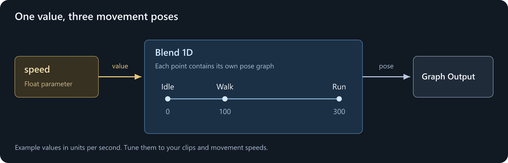

# Blending Movement

Use **Blend 1D** when one value controls a gradual change. For locomotion, that value is often horizontal speed.

We'll extend [the idle graph](/animation/animgraph/getting-started.md) to blend between idle, walk, and run.

## Add a speed parameter

In **Parameters**, use **Add Control Parameter** to add a **Float** named `speed`.

Set its range to `0` through `300`, with a runtime **Default Value** of `0`. This gives the example a useful preview slider; choose a range suitable for your game's movement.

`speed` is our own name, not a special engine input. Until code supplies it, the graph uses its default or saved renderer value.

## Create the blend

Add **Blend > Blend 1D**. Drag `speed` from Parameters onto the graph, connect it to the blend's **Parameter** input, and connect the blend's result to **Graph Output**.



Double-click Blend 1D to edit its points. It starts with two; right-click the axis and choose **Add Point Here** for a third. Select each point and set its name and value:

| Point | Value | Animation |
|---|---|---|
| Idle | `0` | `idle.anim` |
| Walk | `100` | `walk.anim` |
| Run | `300` | `run.anim` |

These speeds are example tuning values in units per second, not required settings.

**Each point owns a small pose graph.** Double-click the point and connect its clip to its own Graph Output:

```text
Inside the Walk point:
Animation Clip (walk.anim) ---> Graph Output
```

Repeat for Idle and Run. Leave looping enabled on the clips and Blend 1D. Use the navigation breadcrumbs to return to the main graph. Remove the original idle node if it is now disconnected.

## Try it

Change `speed` in the Parameters panel while the preview plays.

| Speed | Expected result |
|---|---|
| `0` | Idle |
| `50` | Halfway between idle and walk |
| `100` | Walk |
| `200` | Halfway between walk and run |
| `300` | Run |

Blend 1D blends the neighboring points, rather than playing three unrelated animations at full weight.

It also synchronizes its input poses. For good walk/run blending, the clips should agree on the order of their movement phases, such as left-foot and right-foot contacts. Use matching sync events when their phase timing differs; synchronization cannot repair incompatible motion.

## Smooth the value, not the gameplay

If movement values jump abruptly, insert a **Spring**:

```text
speed ---> Spring ---> Blend 1D ---> Graph Output
```

Try **Hertz** `4` and **Damping Ratio** `1` as a starting point. A damping ratio of `1` settles without oscillation; higher hertz follows changes more quickly.

Your movement code can still respond immediately. Only the animation's speed input is smoothed. Avoid adding smoothing in both places unless that extra delay is intentional.

## Connect movement

For a custom character, supply horizontal movement speed through `Renderer.Animation.Parameters`. [Parameters and code](/animation/animgraph/parameters-and-code.md) has a small component you can use to test this.

For the standard **PlayerController**, name the parameter `move_groundspeed` instead of `speed` and use the controller's assigned renderer. The controller supplies that value to AG2 graphs automatically.

Blending poses does not itself move the GameObject. Start with in-place clips and let your movement code move the character. If the feet slide, check the clips' intended movement speeds and playback rates; a blend-point value alone does not make a stride cover that distance.
