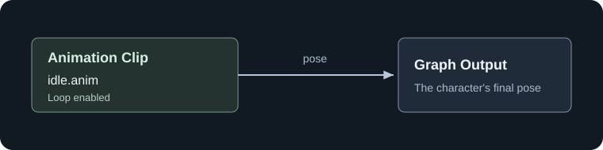

# Your First Graph

Let's make a character play a looping idle. You do not need C# or a state machine for this.

## Before you start

You need a skinned model, its `.skel` skeleton, and a compatible, non-additive `.anim` clip. Use an idle with more than one frame so you can see it playing.

If you only have a model and source animation files, follow [skeletons and clips](skeletons-and-clips.md) first. An animation listed in ModelDoc is not automatically an AG2 clip.

The examples call the clips `idle.anim`, `walk.anim`, `run.anim`, and `wave.anim`. These are example names for your own compatible clips, not built-in asset paths.

## Create the graph

1. In the Asset Browser, open your project's assets folder and choose **Animation Graph** from the create menu's **Animation** category.
2. Choose your **Target Model** and **Target Skeleton**. The dialog can fill in the skeleton from the model or find a compatible one; check that it is the skeleton your clips use.
3. Select your idle from the animation list. Its preview should look correct on the model.
4. Click **Create Graph...** and save the `.ag` inside your project's `Assets` folder.

The editor opens with the selected clip already connected:

You can also create a graph without choosing a clip. It starts with **Reference Pose**, which holds the skeleton's reference pose rather than playing an animation.

## Understand the editor

The **Animation Clips** panel lists clips for the selected skeleton. Drag a clip onto the graph to create an Animation Clip node. Right-click empty graph space to add other nodes, and drag between compatible sockets to connect them.

Select a node to edit its properties. On the idle clip, leave **Loop** enabled and **Speed Multiplier** at `1`.

The preview shows the result of the graph. If it is out of date, use **View > Compile Preview**. Check **Compile Log** for errors and warnings, and save the graph.

## Put it on a character

1. Add a **SkinnedModelRenderer** to a GameObject and assign the same model.
2. Leave **Use Anim Graph** enabled.
3. Assign your `.ag` in the renderer's **Animation Graph** picker.

Play the scene. The character should idle without any parameter code.

This renderer assignment overrides the model's default graph. Clearing the assignment restores the model default; it does not necessarily turn animation off.

## If the character does not animate

| What you see | What to check |
|---|---|
| Reference pose | Is a clip selected and connected to Graph Output? Does Compile Log report a missing asset? |
| A correct but still pose | Is the clip single-frame? Is playback paused? |
| A clip missing from the list | Does it use the graph's exact `.skel` resource? Also check the list's filters. |
| Distorted or incorrectly sized animation | Check the skeleton, source rig, and import scale. |
| Correct preview, wrong result in the scene | Check the renderer's graph assignment and Use Anim Graph setting. |

Next, [blend idle, walk, and run](blending-movement.md) using a speed parameter.
