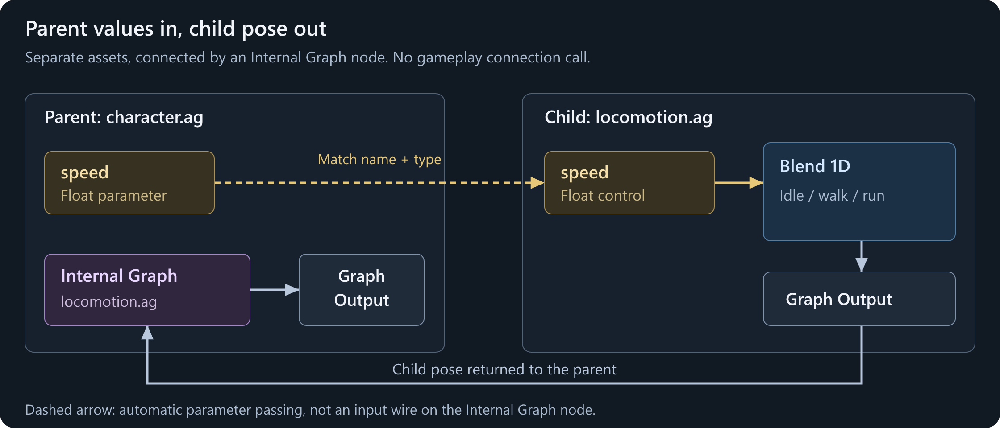
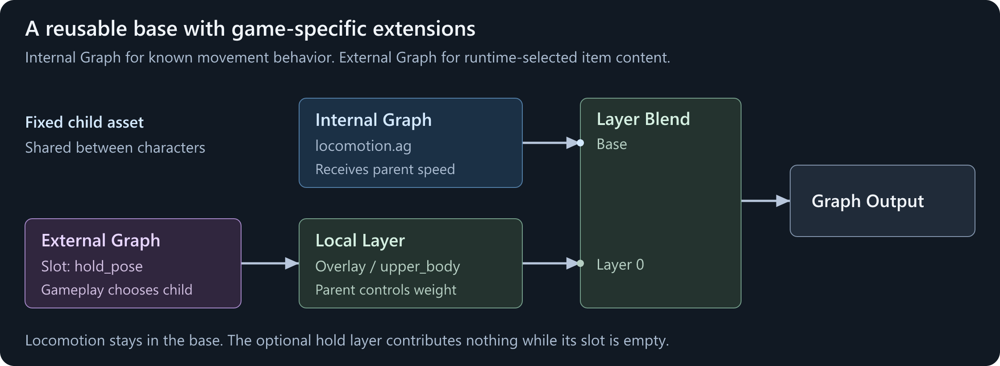

# Internal Graphs

An **Internal Graph** runs another `.ag` asset as part of your graph. The child produces a pose, and compatible parent parameters are passed into it by name.

Use one to turn a large graph into reusable pieces. A shared locomotion graph can handle idle, walking, and running, while each character's main graph adds its own actions, equipment, and procedural adjustments. You can change the shared asset without maintaining a separate copy of its nodes in every parent.

**This is an editor feature, not just a runtime graph builder feature.** Author the parent and child in the AnimGraph editor, assign the child asset on an Internal Graph node, and connect its Result. There is no gameplay `Connect` call.

## Choose the right kind of reuse

| I want to... | Use |
|---|---|
| Reuse a known `.ag` and drive it with the parent's values | **Internal Graph** |
| Let gameplay attach an item- or game-selected graph | [External Graph](/animation/animgraph/external-graphs.md) |
| Organize nodes inside one asset, with explicit typed inputs | **Pose Group** and **Group Input** |

"Internal" does not mean the child is copied into the parent's editor document. It remains a separate asset with its own nodes, parameters, and playback state. In C#, the same feature is called `ReferencedGraph`.

Internal graphs can contain clips, blends, states, layers, and procedural nodes. They return a **pose**, not an arbitrary collection of outputs or a callable gameplay function.

## Example: shared locomotion

Create two assets on the same skeleton:

| Asset | Responsibility |
|---|---|
| `graphs/locomotion.ag` | Turn `speed` into an idle/walk/run pose |
| `graphs/character.ag` | Run locomotion and compose the character's final pose |

These are example paths relative to your project's `Assets` folder. Use your own compatible clips and the same skeleton resource throughout; an Internal Graph does not retarget a different skeleton.



### Build the child

Follow [Blending Movement](/animation/animgraph/blending-movement.md) to create `locomotion.ag`:

1. Add a Float **control parameter** named `speed`, with a runtime default of `0`.
2. Use it to drive a Blend 1D with idle, walk, and run.
3. Connect the blend to Graph Output and save the child.

Preview the child on its own first. Its speed slider should produce the expected movement before you add another graph around it.

### Reference it from the parent

Create `character.ag` using the same skeleton. Add **Graphs > Internal Graph**, then set its **Graph Path** to `graphs/locomotion.ag`. Leave **Graph Variation** blank to use the child's default variation.

Connect **Result** to Graph Output. Optionally connect a suitable idle or Reference Pose to **Fallback**; this provides a pose if the child instance is unavailable. It is not a second pose that blends underneath a working child.

Right-click the Internal Graph node and choose **Reflect Child Parameters to Parent**. This adds the child's missing control parameters to the parent's Parameters panel, so `speed` is available for the parent to supply.

Alternatively, add a Float control parameter named `speed` yourself. Use the same spelling, case, and type as the child. You do not wire the parameter into the Internal Graph node: the runtime matches it by name.

Save the parent and assign **the parent** to the character's Skinned Model Renderer, with Use Anim Graph enabled.

### Drive and preview the parent

Change `speed` in the parent's preview. The child's locomotion should respond just as it did when previewed alone.

Gameplay still writes to the renderer's main graph:

```csharp
Renderer.Animation.Parameters.Set( "speed", 150.0f );
```

This assumes a valid renderer running `character.ag`. See [Parameters and Code](/animation/animgraph/parameters-and-code.md) for a complete driver.

The write goes to the parent's `speed`. When the Internal Graph is evaluated, the value is passed into the child's `speed`. There is no separate child parameter object to find, and no parameter path such as `locomotion.speed`.

## How parameter passing works

The runtime matches each **child control parameter** against the immediate parent's control and virtual parameters. It supplies matched values when the Internal Graph initializes and before evaluating the child.

| Parent and child | Result |
|---|---|
| Matching name and compatible type | Parent value drives the child control |
| No matching parent parameter | Child control keeps its own value, initially its runtime default |
| Matching name but incompatible type | Runtime warns and does not map that input |
| Child virtual parameter | Calculated inside the child, not replaced by a parent value |

The supported control types are **Bool, Float, ID, Vector, and Target**. A Bone Mask virtual parameter is not a child control input. Put shared masks on the skeleton and choose or calculate them inside the graphs that need them.

Passing is one-way: **parent to child**. It does not expose the child's internal calculations as parent parameters or reset a parent's action bool when the child finishes.

A parent value of `0` or `false` is still a supplied value. If you add a matching parent parameter, its value overrides the child's default even when gameplay has never written it.

### The reflection command is an authoring shortcut

**Reflect Child Parameters to Parent** reads the saved child document. It adds missing controls and reflects preview settings for compatible existing controls; it does not keep two editor documents synchronized.

It does not copy the child's virtual-parameter calculations. It also does not repair conflicting names or types: check the log for warnings. Review the parent's **Runtime > Default Value** separately rather than assuming it was copied from the child.

After adding or renaming child controls, update the parent's matching parameters too. Saving a child does not automatically add its new controls to every parent.

### Supply a calculated parent value

The parent can expose a virtual parameter with the name the child expects. For example:

| Graph | Parameter | Meaning |
|---|---|---|
| Parent | `move_groundspeed`, Float control | Live speed supplied by PlayerController |
| Parent | `speed`, Float virtual parameter | A Spring calculation over `move_groundspeed` |
| Child | `speed`, Float control | Input to the movement blend |

Build the Spring calculation inside the parent's virtual `speed` parameter. The child receives the calculated value without needing to know about PlayerController or smoothing.

Keep the virtual parameter at **Graph** lifetime if its smoothing should survive branch changes. See [Virtual parameters](/animation/animgraph/parameters-and-code.md#virtual-parameters).

This is name-based mapping, not a per-node input-remapping table. Two Internal Graph nodes whose children both declare `speed` will receive the same parent `speed`, even though their playback instances are separate.

## Extract an existing pose tree

If the useful behavior already exists in a larger graph, select its nodes and use **Extract to AnimGraph...** from the graph's context menu.

The editor saves the selection as a new `.ag`, adds a Graph Output in that child, and replaces the selection with an Internal Graph referencing it. Existing consumers of the selected pose output are reconnected.

For extraction to be available:

* Work in a pose graph and select removable nodes.
* The selection must have exactly one pose output leaving it.
* Include upstream dependencies, except control-parameter reference nodes, which can be copied automatically.
* The selection's parameter references must resolve to defined controls, not virtual parameters.

If the command is disabled, its tooltip explains why. This restriction on extracting virtual parameters does **not** prevent a hand-authored Internal Graph from receiving a parent's virtual values.

Save the parent after extraction and preview both assets. The new child is reusable; it is no longer just an organizational group in the parent.

## Compose reusable behavior

An Internal Graph's Result can feed a state, a blend, or a layer, not just Graph Output. For example, keep shared locomotion as the base and let an [external hold slot](/animation/animgraph/external-graphs.md#example-custom-item-hold-types) add item-specific upper-body animation:



The Internal Graph receives matching parent movement values. The External Graph does not inherit those values; it supplies a self-contained item pose. The parent decides the layer's weight, mask, and root-motion policy.

For a known set of parameter-driven behaviors, you can instead put different Internal Graph nodes inside parent states and use normal transitions between them. Changing a graph path is not how you switch a live state: author the choices into the parent, or use an External Graph when gameplay must supply a different asset.

Referencing a child containing a state machine does not automatically make the enclosing layer a **State Machine Layer**. If the parent layer needs to enter and leave Off, keep that controlling state machine in the parent and use the setup from [Layers and Masks](/animation/animgraph/layers-and-masks.md).

## Playback, fallback, and nesting

Each Internal Graph node creates its own child instance. Reusing the same asset in two nodes or on two characters does not share their current state, clip position, or transition progress.

The child is evaluated as part of the parent's pose tree. An inactive branch does not run as an independent animation player. When the Internal Graph node initializes again, it resets the child's graph state using the parent's initialization timing; do not expect a paused child to resume where it left off.

Parent synchronization can also supply the child's playback timing. Putting a clip inside an Internal Graph does not isolate it from synchronized blends or layers. The child's events and root motion participate in the surrounding graph's normal composition.

Fallback is used when there is no child instance, not whenever a connected child produces an unwanted result. It does not fix an invalid skeleton, broken child logic, or a clip that has reached its end. A non-looping clip still holds its last pose unless its graph transitions away.

A child can reference another child. Parameter matching happens **at each boundary**: if `character.ag` references `movement.ag`, which references `grounded.ag`, then `movement.ag` must expose the matching inputs that `grounded.ag` needs. Values do not skip an intermediate graph.

Keep references acyclic. Do not make an asset reference itself, directly or through another graph. Nested references create instances and have a runtime depth limit; they are not a way to implement recursive behavior.

Gameplay's `Animation.ExternalGraphs` API only finds slots in the main graph. An external slot inside an internal child is not directly addressable through that API; keep gameplay connection points in the parent.

## Child variations

An Internal Graph node's **Graph Path** and **Graph Variation** select the child asset and its variation. Blank Graph Variation uses the child's default; it does not automatically select a child variation with the parent's name.

The parent can override these node settings in its own authored variations. This is useful when character variants share the same main structure but reference different compatible movement content.

These are authored resource choices, not gameplay parameters or live slot connections. Make sure the selected child variation uses the correct skeleton and parameter contract.

## Optional: reference a child from C#

`GraphBuilder.ReferencedGraph` creates the same kind of node. This factory assumes an authored `graphs/locomotion.ag` with a Float control named `speed` on the given skeleton:

```csharp
using Sandbox.Animation;

public static Graph CreateCharacterGraph()
{
    var builder = Graph.Builder;
    builder.Skeleton = "models/citizen_human/animgraphs/human.skel";

    builder.FloatParameter( "speed", 0, 300 );

    var movement = builder.ReferencedGraph(
        "graphs/locomotion.ag",
        builder.ReferencePose()
    );

    return builder.Create( movement, "character_with_shared_locomotion" );
}
```

The unused return value from `FloatParameter` is intentional: declaring the parameter makes it available to the child's name-based mapping. It does not need a value wire to the referenced node.

Assign the result to `Renderer.Animation.Graph`, retain a strong reference while assigned, and dispose it only after detaching it. See the [runtime builder's ownership rules](/animation/animgraph/runtime-graph-builder/index.md#ownership-and-lifetime).

Declare all controls before adding pose or calculation nodes. `ReferencedGraph` accepts an **asset path**, not another builder's node or an anonymous procedural `Graph`. To attach a procedural graph resource, use an [external slot](/animation/animgraph/external-graphs.md).

## Troubleshooting

| Problem | Check |
|---|---|
| Child previews correctly but stays idle in the parent | The parent declares and supplies the matching `speed` name and type |
| Child's runtime default seems ignored | A matching parent control or virtual parameter overrides it |
| Reflection does not add a recently created input | Save the child, run the command again, and inspect warnings |
| Renaming a child parameter stops gameplay input | Update the parent's contract too; asset boundaries use names |
| Both uses of a child receive the same inputs | Mapping is by name, not per-node input pins |
| Child restarts on state re-entry | Initialization resets its graph state; keep continuous behavior in a continuously active branch |
| Fallback does not replace a finished clip | Completion is not a missing child; use a transition or parent composition |
| The wrong child variation plays | Set Graph Variation explicitly; blank means the child's default |
| An external slot in a child cannot be found | Declare gameplay-accessible slots in the main graph |
| Extraction is disabled | Check the tooltip for dependencies, multiple outputs, or virtual-parameter references |
