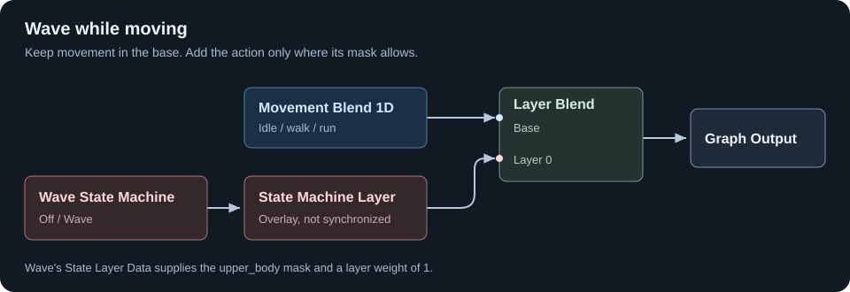

# Layers and Masks

A layer adds animation over a base pose. A bone mask controls which parts of the body it affects.

For example, the legs can keep walking while the upper body waves.

## Choose the kind of layer

| Layer node | Use it for |
|---|---|
| **Local Layer** | A clip or pose controlled by a weight |
| **State Machine Layer** | Actions with entry, exit, and off states |

Both connect to **Layer Blend**. They describe a layer; they do not connect directly to Graph Output as a pose.

**Overlay** blends toward an ordinary pose. **Additive** adds a change to the base pose and needs an additive source. Use Overlay for the ordinary wave clip in this example.

## Make an upper-body mask

Select your `.skel` asset. In **Bone Masks**, add a mask named `upper_body`.

In its bone weights, leave the root, pelvis, and legs at `0`, and set the upper-body bones you want to animate to `1`. Intermediate weights around the spine can soften the boundary. Use your skeleton's own bone names and inspect the mask preview.

Save the skeleton. In the graph, a **Bone Mask** node with **Mask** set to `upper_body` now refers to that mask.

A mask does nothing by itself: connect it to the layer that should use it. Masks belong to the `.skel`, not to the model's old AG1 weightlists.

## Keep locomotion in the base

Start with your [movement blend](blending-movement.md), then add Layer Blend:

```text
Movement Blend 1D ---> Layer Blend.Base
                      Layer Blend.Result ---> Graph Output
```

Leave **Only Sample Base Root Motion** enabled. The action should not replace movement's root motion.

## Add the wave layer

Create a separate State Machine for the upper-body action. It needs two states:

| State | Contents |
|---|---|
| Off | An **Off State**, made with **Add Off State** |
| Wave | Your non-looping wave clip connected to Graph Output |

Set Off as the default. As in [states and transitions](states-and-transitions.md), transition from Off to Wave on `b_wave`, then from Wave to Off on **State Completed**. Use `0.2`-second transitions.

Do not put an idle clip in Off. Off means this layer contributes no pose, letting the base animation show through.

Select the Wave state in the state-machine view. Its **State Layer Data** graph appears in the secondary pane; expand it if collapsed. Add a **Float** node with value `1` and connect it to **Layer Weight**. Add a **Bone Mask** node, choose `upper_body`, and connect it to **Bone Mask**.

```text
Float (1) ----------------> State Layer Data.Layer Weight
Bone Mask (upper_body) ----> State Layer Data.Bone Mask
```

Back in the main graph, connect the action machine through **State Machine Layer**:



Set State Machine Layer's **Blend Mode** to **Overlay** and leave **Is Synchronized** off. The wave should run on its own timeline, not follow the walk cycle.

Use **State Machine Layer**, not Local Layer, for this action machine. It keeps evaluating state transitions even when the layer's weight is zero.

## Try it

Set the preview's movement speed to a walking value. Turn `b_wave` on, then off after the action starts.

The upper body should wave, the legs should keep walking, and the action should fade away when complete.

| Problem | Check |
|---|---|
| The legs also wave | The mask is selected and connected in Wave's State Layer Data |
| The wave follows the walking rhythm | Is Synchronized is off |
| The wave repeats | Loop is off, and `b_wave` is cleared |
| The body twists or collapses | An ordinary wave uses Overlay, not Additive |
| Nothing happens from Off | The action uses State Machine Layer and its transition condition is connected |

For a simpler weighted pose, such as holding an item, use **Local Layer** with its **Input**, **Weight**, and **Bone Mask** inputs connected, then feed its Layer output into Layer Blend.
