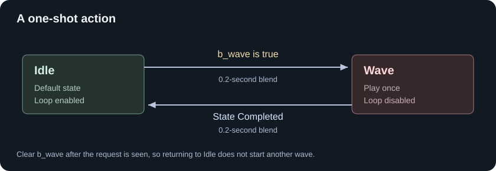

# States and Transitions

Use a **State Machine** for distinct behaviors: moving, jumping, waving, or reloading. A state contains a pose graph. A transition decides when to leave it and how long the blend takes.

Let's make a character idle, wave once, then return to idle.



These arrows are state transitions, not pose connections.

## Create the states

Add a Bool control parameter named `b_wave`, defaulting to `false`.

Add **State Machine** to the main graph and connect its result to Graph Output. Double-click it to open the state-machine view.

Rename the initial state `Idle`. Right-click the canvas and choose **Add State**, then name the new state `Wave`. Right-click Idle and choose **Set as Default State** if it is not already the default.

Double-click each state to build its pose graph:

| State | Pose graph | Clip setting |
|---|---|---|
| Idle | `Animation Clip (idle.anim) ---> Graph Output` | Loop on |
| Wave | `Animation Clip (wave.anim) ---> Graph Output` | **Loop off** |

You can replace Idle's single clip with the [movement blend](blending-movement.md) later. A state can contain a whole blend tree, not just one animation.

## Add the transition into Wave

Hold **Alt** and drag from Idle to Wave to create an arrow. Double-click the arrow to edit its transition graph.

The arrow is a **conduit**: it holds the transition rules for that route. Add a **Transition** node if the conduit does not already have one. Drag `b_wave` from Parameters into this graph and connect it to **Condition**.

```text
b_wave ---> Transition.Condition
```

Select Transition and set **Duration** to `0.2` seconds. Leave **Time Match** as **None** so the wave starts from the beginning.

A transition with no condition connected is disabled. Drawing the arrow alone is not enough.

## Return when the wave finishes

Create a second arrow from Wave to Idle. Inside that conduit, connect **State Completed** to a Transition's Condition. Set the transition duration to `0.2` seconds.

```text
State Completed ---> Transition.Condition
```

By default, State Completed becomes true early enough for the transition to **finish at the end** of the source animation. Enable **At Clip End** if you want to wait until the exact end before starting the blend.

## Try it

In the preview, turn `b_wave` on to enter Wave, then turn it off while the wave plays. The character should finish the animation and blend back to Idle.

If you leave `b_wave` true, the character can enter Wave again after returning. **AG2 bools do not automatically reset.** In game code, treat an action request as a pulse: keep it true for an animation update, then clear it on the next one. Setting it true and false before the graph evaluates may hide the request entirely.

This simple graph accepts wave requests only while in Idle. It does not queue requests or restart a wave already in progress.

## Blend or state machine?

Use a blend for a continuous value, such as walking faster. Use states for a change of behavior with entry, exit, and interruption rules.

Do not replace this state machine with a **Selector** expecting it to watch `b_wave` continuously. Selectors choose on entry and keep that choice until their branch shuts down.

Next, [put the wave on an upper-body layer](layers-and-masks.md) so movement continues underneath.
