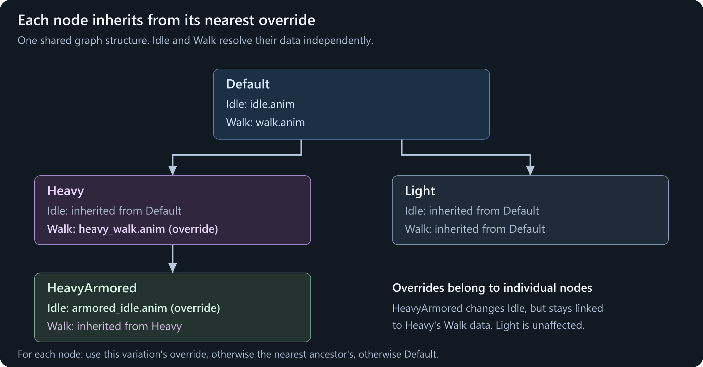

# Variations

**Variations** let one AnimGraph asset describe a family of animation setups. They share the same nodes and connections, but can use different clips, tuning values, bone masks, IK settings, and referenced graphs.

For example, ordinary, heavy, and armored characters can share one locomotion state machine. Each variation supplies the animations and settings that make that character distinct. Fix a transition once instead of maintaining several nearly identical graphs.

A variation can inherit from another variation, so you only override the nodes that need to differ. Each variation compiles into its own graph resource, which gameplay can load.

## What variations are good for

| Use case | Keep shared | Vary |
|---|---|---|
| Character animation styles | Locomotion states and transitions | Idle, walk, run, and action clips |
| A family of items | Draw/hold/action structure | Clips, sampled grip poses, and tuning constants |
| Different compatible character models | Animation logic and parameter names | Target model and selected animation content |
| Adapting a shared setup to another rig | The reusable behavior structure | Skeleton-bound clips, supported bone settings, masks, and child graphs |
| Different action preferences | Selector inputs and option layout | Per-option selection weights |
| Character-specific rules | An ID input and its condition wiring | The list of IDs that condition accepts |

Variations are **authored configurations**, not animation states. Use a [state machine](/animation/animgraph/states-and-transitions.md) to go from walking to jumping during play. Use an [external graph](/animation/animgraph/external-graphs.md) when gameplay needs to attach independently chosen animation content.

They are also different from `GraphBuilder.Variation(...)` and a Parameterized Selector choosing a clip on entry. Those select a pose inside a running graph; this page covers the named variations in the editor's **Variations** panel.

## What is shared, and what can change?

Every graph has a root variation named **Default**. Other variations form an inheritance tree beneath it.

| Part of the graph | Scope |
|---|---|
| Nodes, wires, state machines, transitions, and option layout | Shared by every variation |
| Ordinary node properties outside the variation-data section | Shared by every variation |
| Control parameter definitions and runtime defaults | Shared authoring data; each running graph instance still has its own live values |
| A supported node's variation-data section | Default data, or an override inherited through the variation tree |
| Target model, target skeleton, and per-variation preview setup | Stored on each variation |

**Selecting Heavy does not make every edit Heavy-only.** Adding a state or changing an ordinary node property changes the shared graph.

For example, an Animation Clip node's **Animation**, **Speed Multiplier**, and **Start Sync Event Offset** are variation data. Its **Loop**, **Sample Root Motion**, and **Graph Events** settings are shared. Changing Loop while editing Heavy also changes it for Default.

If variants need fundamentally different node layouts, consider separate assets or different [Internal Graph](/animation/animgraph/internal-graphs.md) references rather than treating variations as independent copies.

## Example: ordinary, heavy, and armored movement

Start with a working `graphs/character.ag` using the [idle/walk/run blend](/animation/animgraph/blending-movement.md). Use clips on the same skeleton for this first example.

We'll keep the blend and `speed` input unchanged:

| Variation | Idle node | Walk node |
|---|---|---|
| Default | Ordinary idle | Ordinary walk |
| Heavy | Inherit Default's idle | Override with a heavy walk |
| HeavyArmored, a child of Heavy | Override with an armored idle | Inherit Heavy's walk |

The run node and all other nodes keep inheriting unless you give them overrides too.



### Create Heavy

Open **View > Variations** if the panel is hidden. The toolbar's **Variation: Default** menu also lets you select a variation or create a new one.

In the Variations tree, right-click **Default** and choose **Create Child Variation**. Name it `Heavy`. The editor selects the new variation.

Use stable, descriptive names. Names must be unique even when only their case differs. The name prompt replaces unsupported characters with underscores; letters, digits, and underscores are straightforward choices.

New variations initially inherit the nodes' data. Creating Heavy does not duplicate the state machine or automatically choose heavier animations.

### Override the walk node

Select the walk Animation Clip, either in its blend-point graph or in the Variations panel's **Nodes** list. The inspector shows **Inherits from 'Default'**, and its inherited variation data is read-only.

Use the override button beside that banner, or the node row's override button. The banner changes to **Overrides for 'Heavy'**.

Set **Animation** to your heavy walk clip. Review **Speed Multiplier** and **Start Sync Event Offset** in the same data block. Leave the shared Loop and root-motion settings alone unless you intend to change every variation.

The node now has Heavy-specific data. Other nodes still inherit from Default.

### Add HeavyArmored

Right-click **Heavy**, not Default, and choose **Create Child Variation**. Name it `HeavyArmored`.

Override its idle Animation Clip and choose the armored idle. Do not override its walk node: that node should show that its data comes from Heavy.

This gives HeavyArmored its own idle while keeping later changes to Heavy's walk. A sibling variation created under Default would not inherit Heavy's override.

### Preview the result

Select Default, Heavy, and HeavyArmored in turn. Use the same `speed` values in the preview to compare their idle and walking poses.

The variation selection changes which node data is shown and which graph variation the editor previews. It does **not** make a renderer in your game start using that variation. [Gameplay selection](#use-a-variation-in-gameplay) is a separate step.

Save the `.ag` and check **Compile Log**. Compilation processes all variations, not just the one you are looking at.

## Understand inheritance before adding overrides

For **each variation-data node**, the editor and compiler look for data in this order:

1. The selected variation's override for that node.
2. The nearest ancestor with an override for that node.
3. The node's Default data.

One variation can inherit its walk clip from Heavy, its run clip from Default, and its idle clip from its own override. There is no single data source for the whole graph.

### Overrides copy a whole data block

Creating an override makes an independent copy of that node's currently inherited variation data. It does **not** create a per-field patch.

Suppose the Walk node inherits an Animation of `walk.anim`, a Speed Multiplier of `1`, and a Start Sync Event Offset of `0`. Creating an override and changing only Animation also captures `1` and `0` in that override.

If you later change Default's Speed Multiplier to `0.9`, that Walk override still uses `1`. It no longer inherits the Walk node's other variation fields individually.

This applies to lists too, such as selector weights or Variation ID Comparison IDs. Keep overrides small in number and create them only where you need an independent node configuration.

### Remove an override to resume inheritance

Use the undo-shaped **remove override** button on the node row or inspector banner. This removes that variation's entire data block for the node and resolves the nearest inherited data again.

Removing a HeavyArmored override can therefore reveal Heavy's data, not necessarily Default's. Descendants that inherited the removed override will also resolve their next available ancestor.

This is not the same as clearing an Animation field. An empty value in an existing override is still that override's value; it does not mean "look up the parent variation."

The inspector identifies the source with **Inherits from '...'**. The Nodes list can be filtered by node name/path or restricted to nodes with overrides on the selected variation. Double-click a row to jump to that node.

## Nodes with variation data

Only the fields in a node's variation-data section are overridden. Its other settings and connections remain shared.

| Node | Per-variation data |
|---|---|
| Animation Clip | Animation, Speed Multiplier, Start Sync Event Offset |
| Time Controlled Animation Clip | Animation |
| Animation Pose | Animation and Time Override |
| Internal Graph | Graph Path and Graph Variation |
| Bone Mask | Mask Override |
| Two Bone IK | Effector Bone and Blend Time |
| Foot IK | Left Foot Bone, Right Foot Bone, and Blend Time |
| Target Warp | Alignment Bone |
| Target Selector | Alignment Bone |
| Parameterized Selector / Parameterized Clip Selector | Option Weights |
| Variation Float | Value |
| Variation ID Comparison | IDs |

The Variations panel lists nodes that support this data, including nodes inside states and other nested pose graphs. A node absent from the list is not made variation-specific merely by selecting a different variation.

Some fields have their own fallback rules. An Animation Pose's negative **Time Override** uses its shared **Fixed Time**, and a connected Time input takes precedence. An empty Bone Mask **Mask Override** uses the node's shared **Mask**. These are field-specific behaviors, not inheritance merging.

### Use Variation Float for tuning

Add **Variation Float** when a graph calculation needs a different constant for each variation. Connect its Float output where a value input is accepted, then override **Value** in the variations that need different tuning.

For example, a Variation Float can supply a character-specific multiplier to a Speed Scale node, or a constant weight to a layer. It changes the animation calculation, not the character's actual gameplay movement speed.

An ordinary Float node does not gain per-variation values. Similarly, a control parameter is for live gameplay input, not a substitute for authored variation data.

### Vary selection weights, not the option layout

Parameterized Selector and Parameterized Clip Selector can use different **Option Weights** in each variation. For example, the same idle options can have weights `4, 1` on Default and `1, 4` on Heavy.

The option count, labels, and connections remain shared. The selector still makes its choice on entry rather than continuously, and it still needs a suitable Float input. See [Clips and Blends](/animation/animgraph/runtime-graph-builder/clips-and-blends.md#select-once-on-entry).

### Variation ID Comparison is not the current variation's name

**Variation ID Comparison** compares its connected ID input against a list that can differ per variation.

For example, connect an `item_type` ID parameter. Default's list might accept `camera` and `tool`, while Heavy's override accepts `rifle` and `launcher`. The input is still supplied by gameplay; the variation only changes the comparison list.

It does not automatically test whether the running variation is named Heavy. The comparison mode and ID input connection are shared.

## Models, skeletons, and preview settings

Each variation has its own **Target Model** and **Target Skeleton**, available through the Variations panel's pickers. The variation context menu also provides **Set Model...** and **Clear Model**.

A newly created variation starts with a **copy** of its parent's current model, skeleton setting, and preview setup. These settings do not continuously inherit through the node-override mechanism. Changing Heavy's target model later does not automatically change HeavyArmored's model.

The target model is what the editor previews and records as the variation's authored model. The target skeleton determines the animation data layout. When no explicit skeleton is set, it can be resolved from that variation's model.

Changing the model does not automatically discard an explicitly chosen skeleton. Always verify both pickers when adapting a variation to another character.

### Reuse on the same skeleton

Models sharing the same skeleton resource can reuse compatible clips and masks. This is the simplest case: select the new preview model, override the animations or tuning that should differ, and leave the skeleton unchanged.

### Adapt to a different skeleton

Variations do not automatically retarget animation. If a variation uses a different skeleton, supply clips bound to that skeleton and review every bone-dependent setting.

That includes inherited clips, Animation Pose sources, masks, IK bones, warp alignment bones, and referenced child graphs. An inherited clip from Default does not become compatible just because the variation's Target Skeleton changed.

Use this when the shared graph structure still makes sense for the new rig. If the required behavior or node layout differs substantially, a separate graph can be clearer.

See [Skeletons and Clips](/animation/animgraph/skeletons-and-clips.md) for preparing compatible assets.

### Preview appearance is not gameplay setup

Preview body groups, material group, attachments, and focus bone belong to the variation's editor preview. They help inspect an armed or differently equipped character without rebuilding that preview each time.

They do not spawn an item or change the runtime renderer's body groups/materials for you. Loading a graph variation also does not replace `Renderer.Model`; assign the appropriate model and gameplay equipment separately.

## Use a variation in gameplay

All variations are authored in **one source `.ag`**. Compilation produces a separate graph resource for each variation:

| Authored variation | Resource path to load |
|---|---|
| Default | `graphs/character.ag` |
| Heavy | `graphs/character.ag+Heavy.ag` |
| HeavyArmored | `graphs/character.ag+HeavyArmored.ag` |

The `.ag+Name.ag` suffix is intentional. Do not create another source file with that name or drop the first `.ag`. Use your actual source path and variation name.


This fragment assumes `Renderer` is a valid Skinned Model Renderer with a model compatible with Heavy's skeleton:

```csharp
using System;
using Sandbox;
using Sandbox.Animation;

var graph = Graph.Load( "graphs/character.ag+Heavy.ag" );
if ( graph is null || !graph.IsValid || graph.IsError )
    throw new InvalidOperationException( "Could not load the Heavy graph variation." );

Renderer.UseAnimGraph = true;
Renderer.Animation.Graph = graph;

Log.Info( $"Graph variation: {graph.VariationId}" );
```

`VariationId` reports which variation the loaded resource was compiled for. `ModelName` reports its authored model; neither is a live variation-switching property.

Load the base `graphs/character.ag` to use Default again. Selecting Heavy in the editor and saving the source does not make the base path mean Heavy.

Different renderers can use different variations of the same source at the same time, with independent playback and parameter values.

### Switching is graph replacement, not a transition

Assign a different variation resource when setting up or deliberately changing the character, not every frame. It replaces the renderer's running graph; it is not a crossfade and does not preserve state-machine progress.

Reapply live gameplay parameters as needed. Saved renderer parameter values follow the normal [parameter persistence rules](/animation/animgraph/parameters-and-code.md#saved-values-and-live-values), but ordinary runtime writes are not a saved variation preset.

Replacing the graph also loses live external-graph connections when the controller is recreated. Reconnect equipped-item graphs deliberately after the switch if they should remain active.

For a continuous gameplay change such as walk to run or idle to reload, use parameters, blends, and transitions inside the graph. Do not repeatedly reload a named variation to simulate a state machine.

## Variations and child graphs

An [Internal Graph](/animation/animgraph/internal-graphs.md) node can override both **Graph Path** and **Graph Variation**. For example:

| Parent variation | Internal Graph's Graph Path | Its Graph Variation |
|---|---|---|
| Default | `graphs/locomotion.ag` | Blank: child's Default |
| Heavy | `graphs/locomotion.ag` | `Heavy` |
| HeavyArmored | Inherit Heavy's node data | Inherit `Heavy` |

The parent's name does not automatically select the same child variation. Set Graph Variation explicitly when the child must use something other than Default.

The selected child still receives compatible matching parent parameters. Its skeleton must be compatible with the parent, just as for any other Internal Graph.

An [External Graph](/animation/animgraph/external-graphs.md) can also receive a variation resource: load `graphs/item_hold.ag+Heavy.ag` and pass that Graph to `Animation.ExternalGraphs.Connect`. Slot ownership and compatibility rules are unchanged, and the child still does not inherit parent control values.

## Saving, compiling, and maintaining variations

Save the shared source asset. The resource compiler generates the named variation resources and their dependencies; there are no separate variation source files to edit.

**Check every variation, not just Default.** A missing skeleton or invalid setup in one variation can fail the overall asset compile. Review warnings as well as errors, and preview any variation affected by a shared-property change.

The base resource references its generated variations, and each variation records its own referenced resources. Do not assume content is excluded from a build just because that variation was not selected in the editor.

Right-click a non-default variation to **Rename** or **Delete** it. Default cannot be renamed or deleted.

Renaming keeps that source graph's hierarchy and node overrides together, but changes the resource name gameplay loads. Update code, prefab/resource references, and other graphs' Graph Variation settings that use the old name.

**Deleting a variation also deletes all its descendants and their node overrides.** Removing one node's override is the narrower action when you only want that node to inherit again.

## Troubleshooting

| Problem | Check |
|---|---|
| Editing Heavy changed every variation | The field or graph structure is shared, not variation data |
| A variation-data field is read-only | Add a node override or select the variation that owns the inherited data |
| A child stopped following part of a parent's node data | Its override copied the entire data block, including fields you did not edit |
| Clearing an animation did not restore inheritance | Remove the override instead of blanking its field |
| A new child uses the wrong parent's clips | Check which variation was selected when creating it and inspect the inherited data source |
| The editor shows Heavy, but the game plays Default | Load `character.ag+Heavy.ag`, not the base `character.ag` |
| Changing a graph variation did not change the model or equipment | Configure the runtime renderer and equipment separately |
| A different rig has missing or incorrect animation | Check inherited clips, skeleton binding, bones, masks, and child graphs |
| A referenced child still uses Default | Set the Internal Graph node's Graph Variation explicitly |
| Variation ID Comparison never matches the variation name | It compares a connected ID against per-variation IDs, not the running variation's name |
| A reload or equipment hold disappears after switching | Graph replacement resets playback and external connections; restore the intended gameplay setup |
| Saving fails although the selected preview looks correct | Inspect all variations and the Compile Log |
