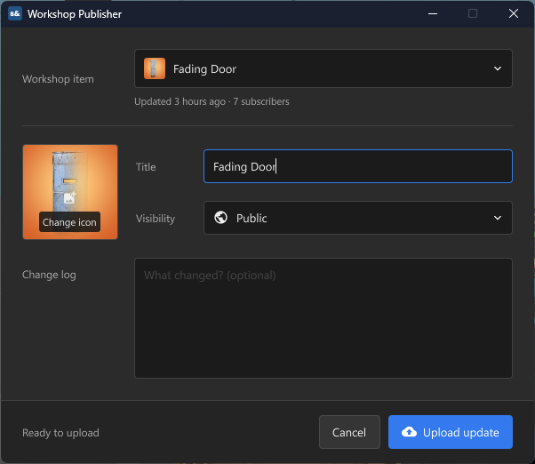

# Addon Project

An addon project adds to a Game Project. You build with the target game's components and assets, then publish the addon to the Steam Workshop for that game.

For example, to make a map for someone else's deathmatch game, you'd create an addon project targeting that game. You get their spawn points, weapon pickups and game rules to build with.

Common uses:

- A map for an existing game
- A model or material pack for a game that loads them from addons
- A custom resource the game defines, like a card or a recipe
- A scripted tool or entity for a game that loads scripts from addons

:::info
Addon projects can't contain compiled C# code, but they can contain [script files](/code/scripting/script-files.md) (`.csx`) and [ActionGraph](/actiongraph/index.md). A script file can define components, so an addon can add its own behaviour to the target game.

:::

## Game Target

In **Project Settings** you select the **Target Game**, either by picking it or by entering its ident. If you change the target game you must restart the editor for the change to apply.

## Publishing

An addon is published as a whole, the same way you publish a game: open the project menu in the editor's title bar and choose **Publish..**. For an addon this opens the **Workshop Publisher**.

- **Workshop item**: choose **Create new item** the first time. After that, pick the existing item to update it.
- **Icon**: the image shown on the Workshop. Choose a `.png` or `.jpg`.
- **Title**: the item's name on the Workshop.
- **Visibility**: Public, Friends only, Private or Unlisted. A new item starts as Unlisted.
- **Addon types**: shown when the target game defines addon types. Pick the ones that describe your addon so players can find it.
- **Change log**: optional notes for this upload.

Press **Create item** for a new item, or **Upload update** for an existing one. When the upload finishes you can open the item's Workshop page from the same window.

:::info
Publishing a single asset, such as one model or map, still works as it always has. That is separate from publishing an addon.

:::
