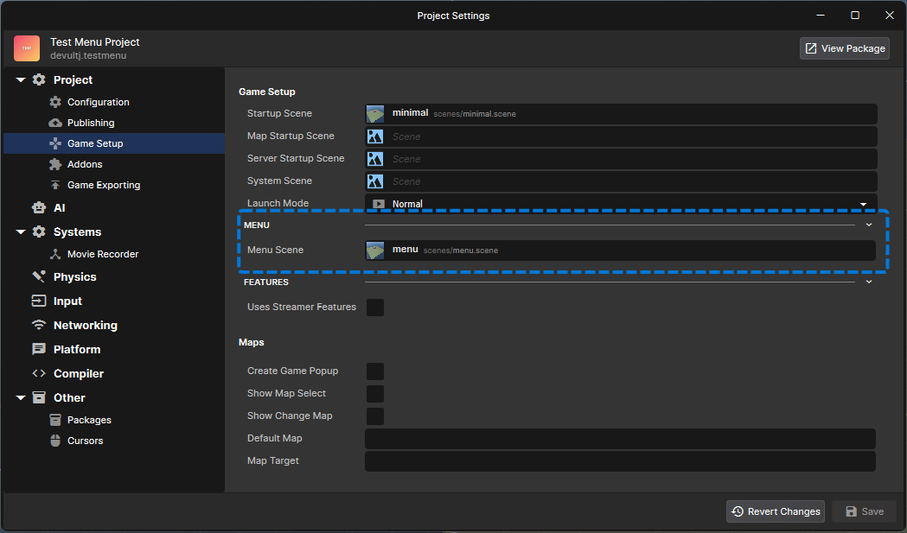

# Menu Scene

Your game can have its own main menu. When someone picks your game in s&box, it loads straight onto your menu scene - your title screen, your background, your buttons - with the platform dock along the bottom so they can still switch games.

Without one, players get a default page made from your Workshop item, and your game isn't loaded until they hit play.

:::info
This is part of the new platform menu, which is opt-in for now - `menu_platform 1`, or **Settings > Game**.
:::

## Setting it up

Make a scene for your menu, then pick it in **Project Settings > Game Setup > Menu Scene**.



It's just a scene. Put whatever you want in it - a camera, some props, a `ScreenPanel` with your UI. Your System Scene is loaded into it too, like any other scene.

## Starting the game

Change scene. Any scene that isn't your menu scene starts the game.

```csharp
public sealed class MainMenu : Component
{
	[Property] public SceneFile GameScene { get; set; }

	public void Play()
	{
		Game.ChangeScene( GameScene );
	}
}
```

You pick where to go, so you can have more than one button - a singleplayer scene, a multiplayer one, a tutorial.

Your Startup Scene is still used when the game's launched some other way, like with a map, or with the platform menu off.

## Lobby, map and settings

Your menu is where players pick how the game starts. Fill in `LaunchArguments` before you change scene, and the game picks them up.

```csharp
public void Play()
{
	LaunchArguments.Map = "facepunch.flatgrass";
	LaunchArguments.MaxPlayers = 16;
	LaunchArguments.Privacy = LobbyPrivacy.FriendsOnly;
	LaunchArguments.ServerName = "My Server";

	Game.ChangeScene( GameScene );
}
```

### Lobby

Make your lobby the same way you always have. `Networking.CreateLobby` uses `MaxPlayers`, `ServerName` and `Password` from `LaunchArguments` over what's in your `LobbyConfig`. For `Privacy`, the more private of the two wins.

If you create it from somewhere that also runs on the menu, like a `GameObjectSystem`, skip it there:

```csharp
void ISceneStartup.OnHostInitialize()
{
	if ( Game.IsOnMenu ) return;

	Networking.CreateLobby( new LobbyConfig { MaxPlayers = 32, Name = "My Game" } );
}
```

### Map

`LaunchArguments.Map` is a map's ident. A `MapInstance` with **Use Map From Launch** on loads it, so point your button at a scene with one of those in it.

### Game settings

Your game's already loaded on the menu, so set your ConVars straight away:

```csharp
[ConVar( "mygame.friendlyfire", ConVarFlags.Replicated | ConVarFlags.Server | ConVarFlags.GameSetting )]
public static bool FriendlyFire { get; set; }
```

```csharp
ConsoleSystem.SetValue( "mygame.friendlyfire", true );
```

They're replicated, so anyone who joins gets them.

## Going back

```csharp
Game.ReturnToMenu();
```

This takes you back to your menu scene and out of any session. The pause menu's **Leave** button does the same. On the host, so does changing scene to your menu scene yourself.

If you joined someone else's server, there's no menu of yours to go back to - the game closes instead.

## Game.IsOnMenu

True while your menu scene is the active scene. It's false once the game starts, and always false for a game without a menu scene.

Components in your menu scene and your game scenes don't need it, since they're only ever in one. It's for code that runs no matter which scene you're on:

- `GameObjectSystem`s, which are created in every scene, your menu included. See the [lobby](#lobby) example.
- Console commands, which can be typed on the menu

## Things to watch for

### You don't need a Quit button

`Game.Close()` is ignored while you're on your menu - the dock is how players leave.

### Leave room for the dock

`ScreenPanel` already lays out around the dock. If you draw UI some other way, like with `HudPainter`, keep it inside `Screen.SafeArea`.
